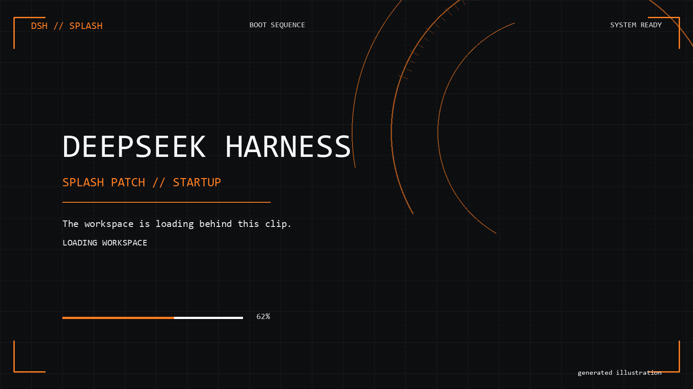
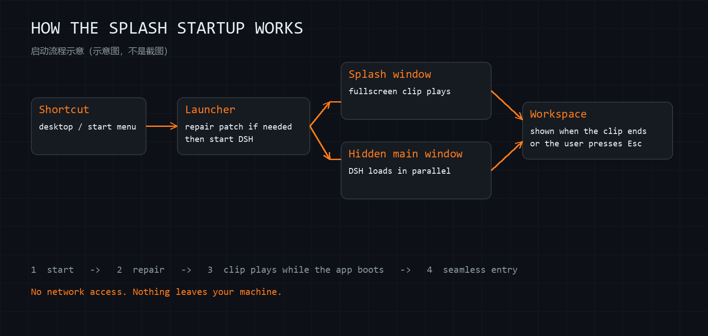
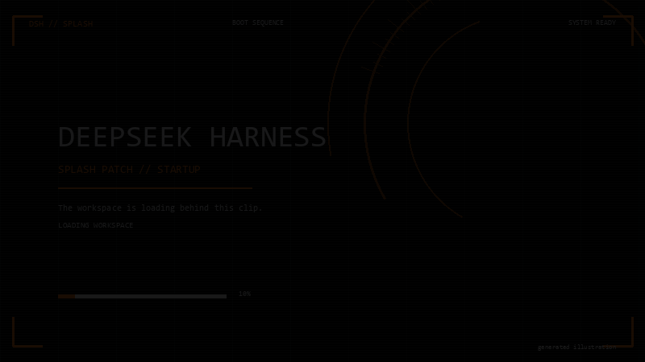

# DSH Splash Patch

Play a fullscreen intro video before the DeepSeek Harness (DSH) desktop UI appears,
while DSH boots behind it - and keep it working after DSH auto-updates.

中文简介：给 DSH 桌面版加一个"开机先播全屏视频、DSH 在后台加载、视频播完（或按 Esc/点击）
再进 DSH"的开屏效果；DSH 更新会替换 `app.asar`，本工具用"自动补丁器 + 看门狗 + 启动器"
在更新后自动把补丁补回来。



*示意图：开屏播放时整个屏幕都是视频，DSH 在后台加载。图片由 `docs/images/generate.py`
用代码绘制，不是截图，也不含任何真实画面或隐私数据。*



*示意图：快捷方式 → 启动器（必要时先补丁）→ 开屏窗口播放视频，同时隐藏的主窗口加载
DSH → 视频播完 / 按 Esc 后无缝进入工作区。*

## Requirements

- Windows 10/11
- DeepSeek Harness desktop installed (developed against `0.2.1-rc.3`)
- Node.js, or the node runtime bundled with DSH (`%USERPROFILE%\.dsh\dsh-runtimes\...`)

## Install

1. Put this folder anywhere you like (e.g. `%USERPROFILE%\dsh-splash-patch`).
2. Run:

   ```powershell
   powershell -NoProfile -ExecutionPolicy Bypass -File .\setup\install.ps1
   ```

   The installer finds DSH automatically. If it cannot, pass the executable:

   ```powershell
   powershell -NoProfile -ExecutionPolicy Bypass -File .\setup\install.ps1 -Exe "D:\Apps\DeepSeek Harness\DeepSeek Harness.exe"
   ```

3. Start DSH from its desktop/start-menu shortcut. If DSH is already running, restart
   it once so the patched `app.asar` is loaded.

## What the installer changes (all local, reversible)

| Location | Change |
|---|---|
| `<DSH install>\resources\app.asar` | Adds a fullscreen splash window + IPC. The pristine archive is backed up to `state\app.asar.unpatched.bak` before the first write. |
| Existing DSH shortcuts | Pointed at `launch\launch-dsh.vbs`. Originals are backed up as `*.lnk.dsh-patch-backup`. |
| Task Scheduler | Per-user task `DSH-SplashPatch-Watchdog` (at logon + every 5 minutes). |

Nothing is added to the DSH profile or your data folder.

## What it does at start-up

## What it does at start-up



1. The launcher silently re-applies the patch if a DSH update replaced `app.asar`
   (only when DSH is not running).
2. The patched DSH creates a frameless fullscreen **splash window** that plays a local video,
   while the hidden main window loads the real application in parallel.
3. When the clip ends (or the user presses Esc / clicks), the splash closes and the
   already-loaded workspace is shown. Safety timers guarantee it can never hang.

All images in this repository are generated from scratch by
`docs/images/generate.py`. They are illustrations, not screenshots, and contain no
personal data, chat content, or DSH assets.

## After a DSH auto-update

- The updater's own restart may show the normal (unpatched) UI **once** - the update
  replaced the archive while DSH was running.
- Opening DSH from the shortcut repairs the patch **before** launch.
- If DSH is opened by some other means, the watchdog repairs it within a few minutes
  after DSH exits, so the next launch is patched again.

If a future DSH version changes the patched code, the patcher **refuses to write**
and records the reason in `state\status.json` / `state\PATCH-UNSUPPORTED.txt`.
DSH continues to work normally (just without the splash).

## Video source

The splash page plays a local file from the DSH resources directory:
`resources\boot-intro-*.mp4`. The name is chosen from
`%DSH_HOME%\boot-animation\selection.json` when that file exists, otherwise
`boot-intro-awakening.mp4`. **No video or DSH asset is redistributed by this repo** -
the files must already exist in your installation.

## Startup video rotation (optional)

By default the splash uses the clip saved in the animation plugin's selection file.
To rotate between several clips across launches, put an array of resource file names in
`resources\splash-rotation.json` (next to `app.asar`):

```json
["boot-intro-cyberpunk.mp4", "boot-intro-awakening.mp4"]
```

Each launch plays the next entry and writes the counter to
`resources\splash-rotation.state`, so launch 1 plays the first clip, launch 2 the second,
then it wraps around.

A rotation file can also live in `%DSH_HOME%\boot-animation\splash-rotation.json`; the
resources copy is checked first. To keep the rotation working after a DSH update, place
the same file next to the patcher (`patcher\splash-rotation.json`) — the patcher installs
it every time it re-patches the archive.

## Test the patcher without touching DSH

```powershell
# copy an unpatched app.asar from a fresh DSH install first
node patcher\apply-patch.mjs --selftest --base .\test\app.asar.pristine
```

The self-test builds throwaway fixtures: patches a pristine archive, verifies it is
idempotent, and verifies that a changed anchor is refused without writing anything.

## Uninstall

```powershell
powershell -NoProfile -ExecutionPolicy Bypass -File .\setup\uninstall.ps1
# also restore app.asar from the backup:
powershell -NoProfile -ExecutionPolicy Bypass -File .\setup\uninstall.ps1 -RestoreAsar
```

## Privacy and security

- No network access, no telemetry, no analytics, no auto-update of this tool.
- Reads/writes only local DSH files listed above; logs stay in `state\`.
- `config.json`, logs, backups and test archives are gitignored.

## Disclaimer

Unofficial local integration helper. Not affiliated with, endorsed by, or supported by
DeepSeek. It modifies files in your own installation and may break DSH updates or
violate its terms; use at your own risk. See `NOTICE.md`.

## License

MIT